  

  
  
  

### Hi there

Penetration tester from Bergamo, Italy. Around **2 years of hands-on pentesting** on web applications, APIs, mobile apps and desktop software for banks and crypto platforms.
I come from an electrical background, so I like the point where software meets hardware: **embedded & IoT security, firmware analysis, industrial protocols**.

- Currently: reproducing and documenting embedded vulnerabilities (firmware extraction, emulation, exploitation)
- Building open-source security tools at **[NightScry](https://github.com/nightscry)**
- Italian (native) · English (B2)

---

### Featured projects

<table>
<tr>
<td width="140" align="center">
  
</td>
<td>
  <b><a href="https://github.com/nightscry/EyeTrace">EyeTrace</a></b>: multi-chain blockchain intelligence tool. Wallet tracing over 6 chains, multi-hop transaction graph, detection of exchanges, mixers and fake tokens. 
   
</td>
</tr>
<tr>
<td align="center"></td>
<td>
  <b><a href="https://github.com/doggoAngel/gohosting-platform">GoHosting</a></b> : Minecraft hosting platform I built alone and ran in production. Stripe payments, automatic LXC provisioning on Proxmox through its API. 
     
</td>
</tr>
<tr>
<td align="center"></td>
<td>
  <b><a href="https://github.com/nightscry/CVE-2015-2050-DAP-1320">CVE-2015-2050 write-up</a></b>: D-Link DAP-1320. Firmware extraction, Ghidra analysis, emulation in Docker + QEMU, command injection in the firmware update. 
     
</td>
</tr>
</table>

---

### What I work with

  

**Security:** web & API pentesting (OWASP WSTG / Top 10) · mobile (OWASP MASVS / MASTG) · reverse engineering
**Tools:** Burp Suite · Ghidra · Frida · Wireshark · mitmproxy · Jadx · Apktool
**Infra:** Linux · Proxmox / LXC · Docker · networking (TCP/IP, VLAN, VPN)
**Hardware / OT:** Arduino · Raspberry Pi · ESP8266 · Modbus TCP · PLC lab · KNX

---

All offensive security work is done in labs or on systems I'm authorised to test.
